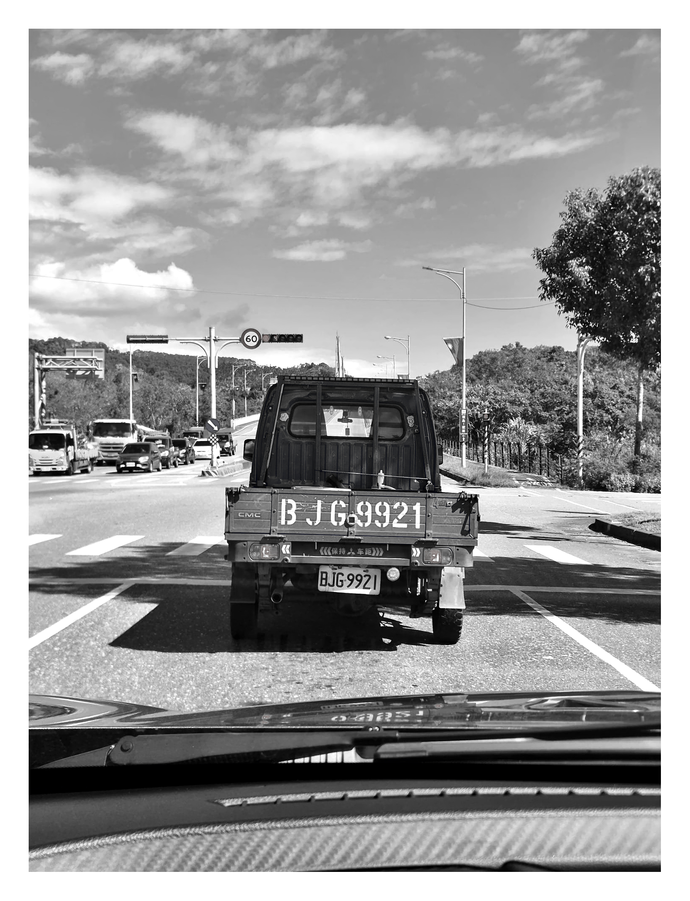

{: loading="lazy"}

Taiwan is an exceptional place. I recently went there with my family for a homecoming trip. I had lived there for nine years (!) during high school, but had not visited for over 15 years.

Describing Taiwan to someone who has never been there usually involves comparison, and this is probably the best jumping off point.

Culturally, it feels like a civilised blend of Japan, China, and ~The West~. The third of these is usually left out, but you do see it if you look, from the way restaurants are themed to how advertisements are pitched.

Developmentally, it feels like a run-down version of South Korea in most places. The tropical climate, consistent rain, and high humidity means that buildings degrade fairly quickly and are quick to accumulate a certain type of black slime, similar to what you see in Malaysia and other high-humidity, equatorial places.

Taiwanese people are kind and proud. There is a sense of eagerness to show tourists the culture, as long as yo uare respectful and engaged. It is difficult ot have a bad time if you are friendly and open-minded, as this will almost always be reciprocated.

There is something for everyone in Taiwan. An incredible art scene, food and night markets, coffee, nature, - all accessible with world-class public transport.

If you, reader, have not yet been, I would highly recommend it.